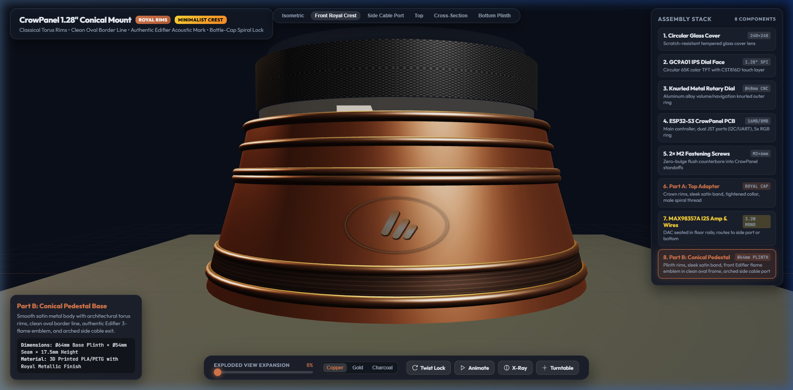

# CrowPanel 1.28" ESP32-S3 Rotary Touch Display — Royal Rimmed Modular Speaker Mount Base (Minimalist Vector Edition)

A custom-engineered **2-part royal conical enclosure** designed to mount the **Elecrow CrowPanel 1.28" Round Display Board** (`DHE38128D`) onto an external speaker enclosure. Features a smooth satin conical body accented with **classical architectural torus rims**, a **clean minimalist oval border line**, and the authentic **pure-vector 3-flame EDIFIER acoustic logo** (zero pixelation, no text, no floral decoration), housing an internal **MAX98357A I2S Mono DAC/Amp Breakout Board** with a broad bottle-cap spiral locking mechanism and dual cable routing.

---

## 📸 Interactive 3D Exploded Viewer & Preview

Open the interactive 3D model in your browser to inspect the architectural rims, clean oval border line, authentic Edifier acoustic flame emblem, side cable port, and twist-lock action:  
👉 **[`CrowPanel_1.28_3D_Exploded_Model.html`](file:///d:/ESP32Radio/Boards/CrowPanel_1.28_Rotary/3D_Printable_Speaker_Base/CrowPanel_1.28_3D_Exploded_Model.html)**

---

## 🏛️ Royal Rimmed Minimalist Design Architecture

The revised design focuses on timeless classical proportions and pristine geometric purity:

1. **Prominent Architectural Torus Rims**:
   - **Base Plinth Rim**: Stepped $\varnothing 64\text{ mm} \to \varnothing 62\text{ mm}$ plinth footing with accent bead fillet.
   - **Mid Dividing Rims**: Raised horizontal torus bead fillets framing the smooth satin body bands.
   - **Seam Mating Rim**: Architectural stepped collar where Part A meets Part B, turning the split line into an intentional decorative band.
   - **Crown Lip Rim**: Stepped double bead rim encircling the upper collar around the knurled dial.
2. **Clean Minimalist Oval Border Line**:
   - Centered on the front face, a single, smooth, elegant oval line border frames the acoustic mark with classical restraint. All floral leaves, rosettes, crowns, and ribbons have been removed for an uncluttered look.
3. **Pure-Vector Authentic EDIFIER Logo (Zero Pixelation)**:
   - Extracted directly from authentic vector brand assets via continuous periodic B-splines (`scipy.interpolate.splprep`).
   - Sliced as a true CAD vector boundary solid mesh rather than a stepped displacement heightmap, guaranteeing silky-smooth curves with **zero voxel stepping or Minecraft-like pixelation**.
   - Wordmark ("EDIFIER") text removed for a clean, iconic emblem presentation.
4. **Broad Bottle-Cap Spiral Thread**:
   - Smooth $P = 4.5\text{ mm}$ pitch, $1.25$ turns ($\approx 450^\circ$), and generous $0.45\text{ mm}$ radial clearance. Spins freely on and off like a bottle cap without binding.
5. **Massive Monolithic Screwing Rim with Open U-Slots**:
   - Built directly from the official **CrowPanel Eagle PCB CAD layout**, providing a massive, rigid, continuous internal shelf ($R = 17.5\text{ to }23.55\text{ mm}$, $2.0\text{ mm}$ thick) seamlessly bonded to the outer conical wall.
   - **Front-View Parity Inversion ($X \to -X$)**: Because the CrowPanel board is seated **face-up** (with the LCD screen and rotary knob pointing upwards toward the user), viewing from the front inverts horizontal coordinates relative to Eagle CAD's rear component layer (Layer 1).
   - **Open U-Shaped Screw Holders**:
     - **T2 Standoff**: Top-Left / NW at $(-13.506, +13.506)\text{ mm}$ (Angle $135^\circ$).
     - **T1 Standoff**: Bottom-Right / SE at $(+13.506, -13.506)\text{ mm}$ (Angle $315^\circ$).
     - Engineered as **open U-slots** ($2.4\text{ mm}$ width) facing inward toward the center instead of closed 'O' holes. The board and brass standoffs slide smoothly into position with zero alignment friction!
   - Under each U-slot, a flat ceiling step at $Z = 3.0\text{ mm}$ accommodates standard M2 screw heads directly against the underside of the shelf.
6. **Schematic-Matched Precision Plug Chutes (92.4% Solid Shelf Preserved)**:
   - Engineered directly from the official **CrowPanel Eagle CAD layout** (`ESP32 Display-1.28-V1.0.brd`) and component footprints, with coordinates horizontally mirrored for front-view insertion:
     - **J34 (UART 1.25-4P)**: Receptacle center at $(-12.30, 6.91)\text{ mm}$, plug envelope $X \in [-20.0, -10.5]\text{ mm}$, $Y \in [2.5, 9.8]\text{ mm}$ (**West**).
     - **J36 (Audio / I2C 1.25-4P)**: Receptacle center at $(-12.32, -3.82)\text{ mm}$, plug envelope $X \in [-20.0, -10.5]\text{ mm}$, $Y \in [-8.2, -0.8]\text{ mm}$ (**West**).
     - **J37 (Power / USB 1.25-4P)**: Receptacle center at $(+13.22, 11.38)\text{ mm}$, plug envelope $X \in [8.5, 15.5]\text{ mm}$, $Y \in [7.0, 14.5]\text{ mm}$ (**East**).
   - **Solid Support Bridge**: A solid $3.3\text{ mm}$ wide radial rib ($Y \in [-0.8, 2.5]\text{ mm}$) is preserved on the West rim between J34 and J36 to firmly support the PCB.
   - **Outer Envelope Protection**: Cutter envelope is strictly bounded at $R \le 20.5\text{ mm}$ (inside male thread root $R = 20.4\text{ mm}$ and crest $R = 21.8\text{ mm}$). Zero threads are compromised!
   - **85–92% Solid Rim Preserved**: Rather than cutting away over $31.5\%$ of the shelf ($246\text{ mm}^2$), the new precision pockets remove only $59.5\text{ mm}^2$ (Option 1: **92.4% solid shelf preserved**).
   - **Full Vertical Drop**: Plugs and wires drop straight through into Part B with zero horizontal floors or ledges.
7. **Vertical Screwdriver & Screw Clearance Gaps in Threaded Neck**:
   - Directly beneath the two M2 screw locations at $(-13.506, +13.506)$ and $(+13.506, -13.506)$, **$5.2\text{ mm}$ vertical clearance channels** extend through the threaded neck ($Z = -6.8\text{ to }+3.0\text{ mm}$).
   - This provides **100% direct vertical access from underneath**: an M2 screw drops straight up into the brass standoff, and any standard screwdriver inserts vertically without hitting the neck wall.
   - At $Z = 3.0\text{ mm}$, a flat ceiling step provides a rock-solid clamping seat for M2 screw heads ($\varnothing 3.8\text{ mm}$).
   - Zero outer protrusion ($R \le 20.4\text{ mm}$ root) ensures 100% smooth screwing into the already-printed Part B pedestal!

---

## 📐 Dimensional & Mechanical Specifications

| Parameter | Part A (Top Adapter) | Part B (Bottom Pedestal) |
| :--- | :--- | :--- |
| **Watertight STL** | [**`CrowPanel_1.28_Conical_Top_Adapter.stl`**](file:///d:/ESP32Radio/Boards/CrowPanel_1.28_Rotary/3D_Printable_Speaker_Base/CrowPanel_1.28_Conical_Top_Adapter.stl) | [**`CrowPanel_1.28_Conical_Bottom_Pedestal.stl`**](file:///d:/ESP32Radio/Boards/CrowPanel_1.28_Rotary/3D_Printable_Speaker_Base/CrowPanel_1.28_Conical_Bottom_Pedestal.stl) |
| **Watertight Status** | **Yes** (100% Manifold, 1.33 MB, 8,931 mm³) | **Yes** (100% Manifold, 1.68 MB) |
| **Height** | $8.5\text{ mm}$ body ($+ 5.8\text{ mm}$ threaded neck) | $17.5\text{ mm}$ ($26.0\text{ mm}$ total assembled height) |
| **Diameters** | $\varnothing 50.4\text{ mm}$ Top $\to \varnothing 54.0\text{ mm}$ Seam | $\varnothing 54.0\text{ mm}$ Seam $\to \varnothing 64.0\text{ mm}$ Base Plinth |
| **Architectural Rims** | Crown lip rim, mid bead rim, seam rim | Seam rim, mid bead rim, plinth bead rim |
| **Front Emblem** | Sleek satin finish | Pure-Vector Edifier 3-flame mark in clean oval border line |
| **Thread Type** | Male Bottle-Cap Spiral ($P = 4.5\text{ mm}$, $1.25$ turns, zero outer protrusion) | Female Helical Socket ($0.45\text{ mm}$ clearance) |
| **Board Collar** | $\varnothing 47.10\text{ mm}$ ID $\times 3.5\text{ mm}$ depth (solid screwing rim with U-slots) | N/A |
| **Fasteners** | 2× M2 U-Slot Seats + 5.2mm vertical neck access channels | 3M VHB Flat Base Footprint |
| **Plug Clearance** | Dedicated Eagle-mapped bays for J34, J36, and J37 | $\varnothing 6.5\text{ mm}$ bottom hole + $9\times 7\text{ mm}$ arched side port |

---

## 🖨️ Recommended 3D Printing & Slicing Settings

* **Orientation**: 
  - **Part A**: Print top-face down (seam facing up) or seam down.
  - **Part B**: Print flat on its $\varnothing 64\text{ mm}$ base.
* **Supports**: **None needed** (all thread flanks have self-supporting $45^\circ$ angles, and the side arch bridges cleanly).
* **Layer Height**: $0.16\text{ mm}$ (recommended for sharp rim definition) or $0.20\text{ mm}$.
* **Infill**: $25\%$ Gyroid for balanced weight and acoustic damping.
* **Perimeters**: 4 walls ($1.6\text{ mm}$ solid perimeter shell).
* **Finishing**: Can be printed in Copper/Bronze/Gold silk PLA or primed and spray-painted with antique copper/brass metallic paint for a luxury chalice appearance.

---

## 📂 Source Code & Generator Files

* [`CrowPanel_1.28_Conical_Top_Adapter.stl`](file:///d:/ESP32Radio/Boards/CrowPanel_1.28_Rotary/3D_Printable_Speaker_Base/CrowPanel_1.28_Conical_Top_Adapter.stl) — Production Watertight STL (Part A).
* [`CrowPanel_1.28_Conical_Bottom_Pedestal.stl`](file:///d:/ESP32Radio/Boards/CrowPanel_1.28_Rotary/3D_Printable_Speaker_Base/CrowPanel_1.28_Conical_Bottom_Pedestal.stl) — Production Watertight STL (Part B).
* [`CrowPanel_1.28_3D_Exploded_Model.html`](file:///d:/ESP32Radio/Boards/CrowPanel_1.28_Rotary/3D_Printable_Speaker_Base/CrowPanel_1.28_3D_Exploded_Model.html) — Interactive 3D Exploded Assembly Web Viewer.
* [`CrowPanel_1.28_Speaker_Mount_Base.scad`](file:///d:/ESP32Radio/Boards/CrowPanel_1.28_Rotary/3D_Printable_Speaker_Base/CrowPanel_1.28_Speaker_Mount_Base.scad) — Parametric OpenSCAD script.
* [`generate_base_model.py`](file:///d:/ESP32Radio/Boards/CrowPanel_1.28_Rotary/3D_Printable_Speaker_Base/generate_base_model.py) — Watertight Python STL generation script.
* [`README.md`](file:///d:/ESP32Radio/Boards/CrowPanel_1.28_Rotary/3D_Printable_Speaker_Base/README.md) — Comprehensive technical manual and assembly guide.

